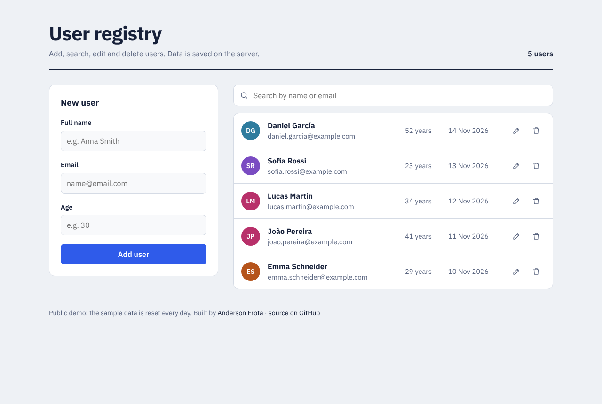

# Cadastro de Utilizadores

Aplicação full stack de cadastro de utilizadores: frontend em **React** (Vite) e **API REST serverless** em Netlify Functions, com os dados guardados no **Netlify Blobs**.

**Demonstração:** [tela-cadastro-usuario.netlify.app](https://tela-cadastro-usuario.netlify.app)



## Funcionalidades

- Registar, editar e apagar utilizadores (com confirmação antes de apagar)
- Pesquisa por nome ou e-mail
- Validação no formulário e no servidor, com mensagens por campo
- E-mail único (sem distinguir maiúsculas e minúsculas)
- Estados de carregamento, lista vazia e erro de ligação
- Layout responsivo e acessível (navegação por teclado, `aria-*`)
- Dados de demonstração repostos todos os dias por uma função agendada

## API

| Método | Rota | Descrição |
|---|---|---|
| `GET` | `/api/usuarios?busca=texto` | Lista (mais recentes primeiro), com pesquisa opcional |
| `POST` | `/api/usuarios` | Cria `{ nome, email, idade }` |
| `PUT` | `/api/usuarios/:id` | Atualiza |
| `DELETE` | `/api/usuarios/:id` | Apaga |

Erros devolvem `{ erro, campos }` com o código HTTP adequado (400, 404, 409).

## Estrutura

```
frontend/                  React + Vite
  src/App.jsx              lista, pesquisa, edição, confirmação
  src/Formulario.jsx       formulário com validação
  src/api.js               cliente da API
netlify/functions/
  usuarios.mjs             API REST
  repor-demo.mjs           função agendada (reposição diária)
netlify/lib/usuarios.mjs   regras de negócio (testáveis sem Netlify)
tests/api.test.mjs         testes da API (node:test)
```

## Correr localmente

```bash
npm install
npm test                      # testes da API
npm i -g netlify-cli
netlify dev                   # frontend + API em http://localhost:8888
```

## Publicar no Netlify

Ligar o repositório no Netlify. O `netlify.toml` já define o build (`npm run build`), a pasta publicada (`frontend/dist`) e as funções. O Netlify Blobs não precisa de configuração.

## Histórico

A primeira versão foi feita no curso DevClub com Express, Prisma e MongoDB. Esta versão 2 passou a API para serverless e reescreveu o frontend com validação, edição, pesquisa e testes.

## Autor

**Anderson Frota Gonçalves** · [Portfólio](https://andersonfrota.netlify.app) · [LinkedIn](https://www.linkedin.com/in/andersongfrota)
